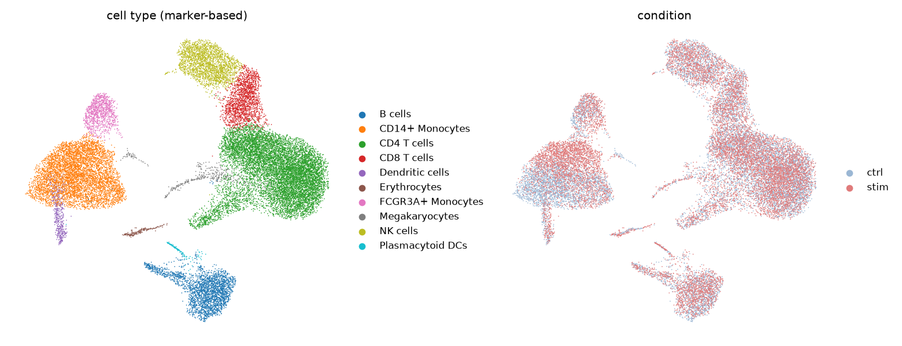
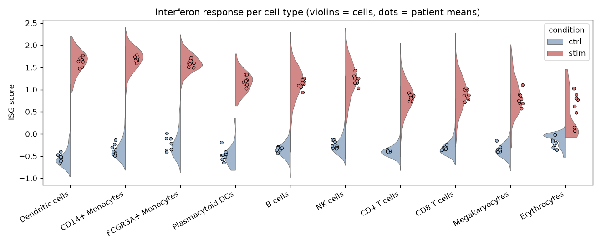
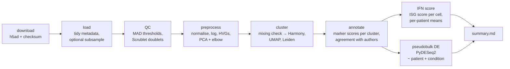
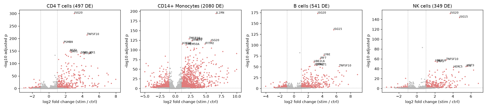
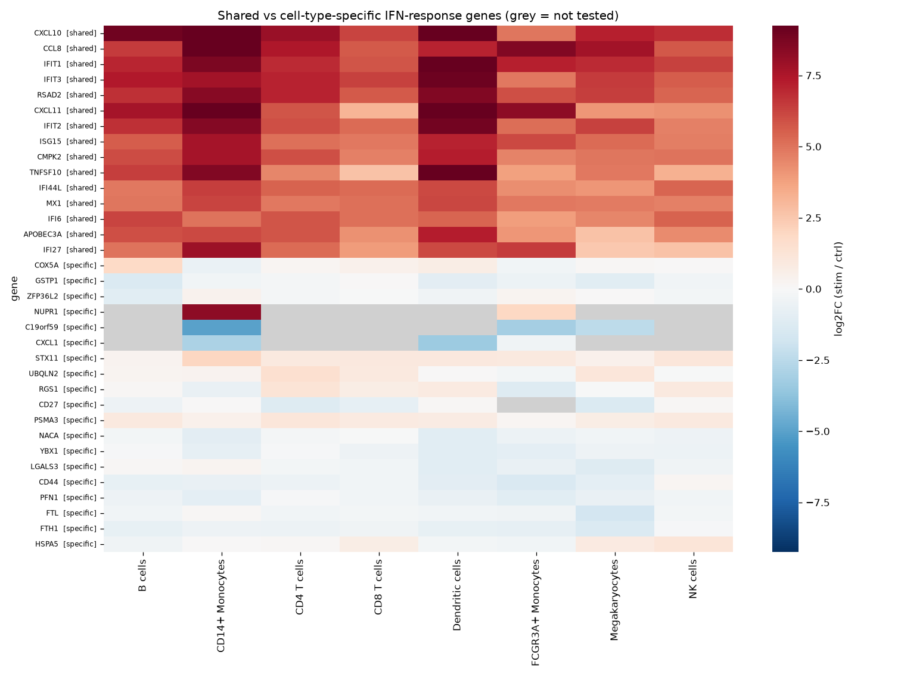

# How do immune cell types respond to interferon-β?

A small, reproducible single-cell RNA-seq analysis of human PBMCs stimulated with
interferon-β, built with Scanpy, PyDESeq2 and Snakemake. One command runs everything
from download to figures in about 5 minutes on a laptop.


<p align="center">
  <br>
  <em>UMAP of 24,463 PBMCs coloured by marker-based cell type (left) and condition (right).</em>
</p>

<p align="center">
  <br>
  <em>Interferon-stimulated gene (ISG) score per cell type. Violins show cells; dots show the
  mean for each of the 8 patients, which are the actual replicates.</em>
</p>

## Question

Interferon-β triggers an antiviral program in almost every cell. Do all immune cell
types respond the same way? This analysis asks which PBMC types respond most strongly,
and which response genes are shared versus specific to one cell type.

## Data

Kang HM, Subramaniam M, Targ S, *et al.* **Multiplexed droplet single-cell RNA-sequencing
using natural genetic variation.** *Nature Biotechnology* 36, 89–94 (2018).
[doi:10.1038/nbt.4042](https://doi.org/10.1038/nbt.4042) · GEO
[GSE96583](https://www.ncbi.nlm.nih.gov/geo/query/acc.cgi?acc=GSE96583)

PBMCs from 8 lupus patients were split: one half was left untreated (`ctrl`) and the
other half was stimulated with IFN-β for 6 hours (`stim`). The cells were pooled and
demultiplexed by genotype (demuxlet). The pipeline downloads the authors' processed count
matrix, the same file served by `pertpy`'s `pt.dt.kang_2018()` loader, and verifies its
SHA-256. Raw data is never stored in the repository.

## Pipeline



| Step | Script | Key outputs |
|---|---|---|
| QC | `scripts/qc.py` | `figures/qc_distributions.png`, `results/qc/qc_thresholds.tsv` |
| Normalisation, HVGs, PCA | `scripts/preprocess.py` | `figures/pca_elbow.png` |
| Integration check, UMAP, Leiden | `scripts/cluster.py` | `figures/umap_overview.png`, `results/clustering/integration_assessment.tsv` |
| Annotation | `scripts/annotate.py` | `figures/marker_dotplot.png`, `results/annotation/*` |
| IFN response | `scripts/ifn_score.py` | `figures/ifn_score_by_cell_type.png`, `results/ifn/*` |
| Pseudobulk DE | `scripts/pseudobulk_de.py` | `figures/de_volcanoes.png`, `figures/de_top_genes_heatmap.png`, `results/de/*` |
| Summary | `scripts/summarize.py` | `results/summary.md` |

All parameters (QC MAD multipliers, HVG count, resolution, seed, DE cut-offs, marker and ISG
gene lists) live in [`config/config.yaml`](config/config.yaml).

## How to run

```bash
git clone https://github.com/LuckyAllieCat/scrnaseq-ifn-response.git
cd scrnaseq-ifn-response
conda env create -f environment.yml      # or: mamba env create -f environment.yml
conda activate scrnaseq-ifn

snakemake --cores 4                      # full dataset, ~5 min, ~3 GB RAM
```

Other options:

```bash
snakemake --cores 2 --configfile config/ci.yaml     # 400-cell smoke test (what CI runs), outputs in ci_out/
snakemake --cores 4 --config subsample_n=5000       # quicker run on a stratified subsample
pytest -q tests                                     # unit tests for the helper functions
```

`notebooks/results_overview.ipynb` only loads and displays the finished results.

## Results

Full numbers are in [`results/summary.md`](results/summary.md).

- **QC.** 24,463 of 24,673 cells pass: Scrublet flagged 188 doublets, and the MAD-based
  thresholds removed the rest. The authors had already filtered the matrix, so few cells fail.
- **Integration.** Before correction, neighbouring cells were poorly mixed by condition
  (score 0.16, where 1 means perfectly mixed), because the IFN response dominates
  expression. Patients mixed at 0.73. Harmony on patient and condition raised both to
  about 0.79. This corrected embedding is used only for clustering and annotation;
  DE uses the raw counts.
- **Annotation.** The marker-based labels for the 13 Leiden clusters agree with the
  authors' labels for **90.7%** of cells (adjusted Rand index 0.85). B cells, monocytes,
  NK cells and DCs agree for at least 95% of cells. The main disagreement is at the CD4/CD8
  T-cell boundary (61% of the authors' CD8 T cells are called CD8). The analysis also
  finds a small plasmacytoid DC cluster and an erythrocyte cluster, which the authors'
  labels don't separate.
- **Which cell types respond most?** Myeloid cells respond most. Dendritic cells and
  CD14⁺ monocytes have the largest rise in ISG score (+2.2 and +2.0, consistent across all
  8 patients) and by far the most DE genes (CD14⁺ monocytes: 2,080 at padj < 0.05 and
  |log2FC| ≥ 1). FCGR3A⁺ monocytes come next (834), then B cells (541), CD4 T cells (497),
  NK cells (349) and CD8 T cells (219). Lymphocytes respond clearly, but less strongly.
- **Shared vs specific.** 166 genes respond in at least 6 of the 8 tested cell types. These
  make up the core antiviral program: *ISG15, ISG20, IFI6, IFIT1/2/3, MX1, OASL, RSAD2,
  IRF7, CXCL10, TNFSF10*. 1,690 genes respond in only one cell type. Most of these are in
  CD14⁺ monocytes, reflecting their much larger response (for example *STX11, ZFP36*). Some
  shared genes also differ in strength: *CXCL11* and *TNFSF10* are induced far more in
  myeloid cells than in T and NK cells. NK cells specifically induce
  *IFNG*, and CD8 T cells change cytotoxic genes such as *GZMM*.

<p align="center"></p>
<p align="center"></p>

## Limitations and what I'd do next

- **"Specific" partly means "better powered".** A gene counts as cell-type specific if it
  passes the cut-offs in only one cell type. Large populations (monocytes, CD4 T cells)
  have more power, so some "specific" genes are simply below threshold elsewhere. A formal
  interaction test (`~ patient + cell_type * condition`) or a comparison of effect sizes
  with confidence intervals would separate true specificity from power differences.
- **Cluster-level annotation.** Each cluster gets one label, so mixed clusters stay mixed.
  The CD4/CD8 boundary is the weakest call. A reference-based tool (CellTypist, or
  label transfer from an Azimuth PBMC reference) and sub-clustering of T cells would
  sharpen it.
- **The "Megakaryocyte" cluster** has a clear platelet signature (*PPBP, PF4, TUBB1*), but
  the authors labelled most of these cells as T cells. They are most likely
  platelet–leukocyte aggregates, so their DE results should be read with care.
- **Rare populations are not tested.** Plasmacytoid DCs (133 cells) and erythrocytes fall
  below the minimum of 10 cells per pseudobulk sample. pDCs are a key interferon-producing
  cell, so a larger dataset would be needed to say how they respond.
- **Processed input.** The pipeline starts from the authors' filtered matrix, in which
  mitochondrial genes are absent, so the % mitochondrial filter could not be applied.
  Starting from the GEO 10x matrices would allow full QC, including ambient-RNA correction
  (e.g. SoupX), which matters for strongly induced genes like *CXCL10*.
- **Next steps:** pathway enrichment of the shared and specific sets (GSEA on the
  PyDESeq2 statistics), a cell-type × condition interaction model, and repeating the
  analysis on another IFN-stimulation dataset to check that the cell-type ranking replicates.

## Repository layout

```
config/       config.yaml (all parameters), ci.yaml (tiny CI run)
workflow/     Snakefile
scripts/      one script per step + common.py (pure, tested helpers)
tests/        pytest unit tests
notebooks/    results_overview.ipynb (display only)
results/      tables written by the pipeline
figures/      figures written by the pipeline
data/         downloaded and intermediate data (gitignored)
```

## License

MIT. See [LICENSE](LICENSE).
